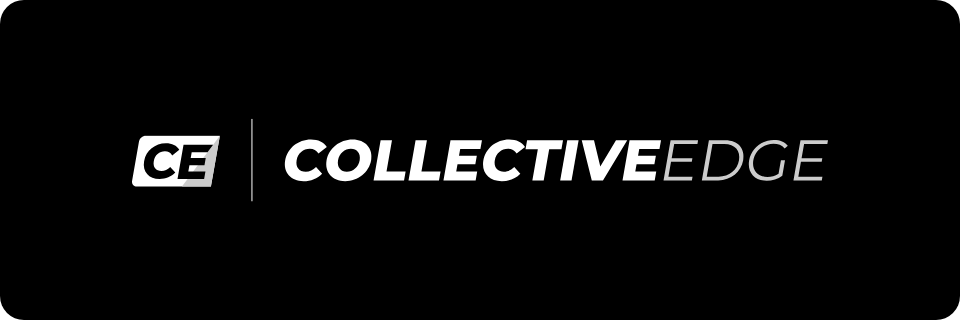
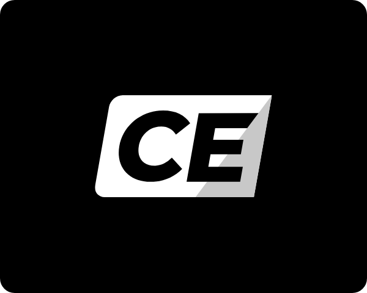
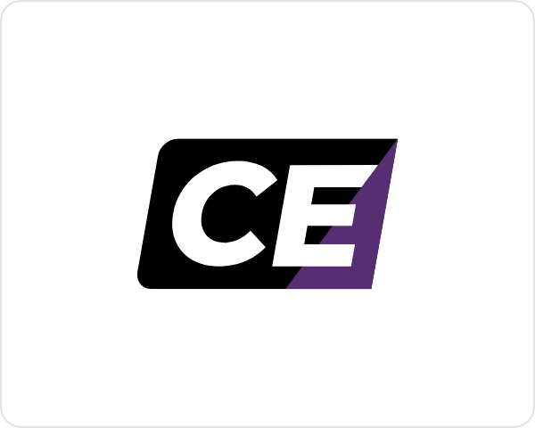
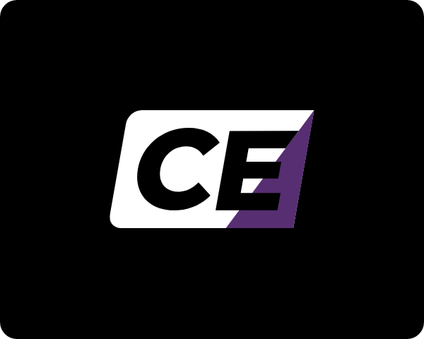
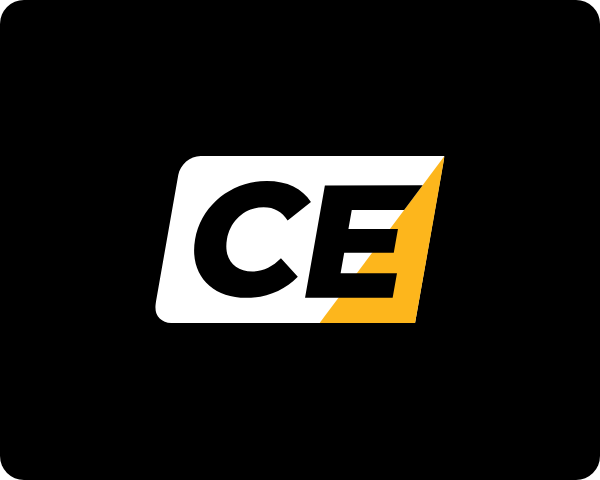

# Collective Edge · logo and brand pack

Everything needed to put the Collective Edge brand on something. No install, no account, no git.

If you only read one line: use the SVG files, set type in Montserrat, and the brand is black and white. There is no brand color.

If Collective Edge is appearing **beside Royal Ambulance, Apex Paramedics or anyone else**, read [Powered by Collective Edge](#powered-by-collective-edge). That is how this brand shows up most of the time.

If you are building anything with a **chart, a table of numbers or a dashboard**, read [Color for data](#color-for-data) below as well.

---

## Download

**[⬇ Download the whole pack](https://github.com/collective-edge/collective-edge-brand-kit/archive/refs/heads/main.zip)** · logos, fonts and this guide in one zip. Unzip it and open the `for-humans` folder.

For one file on its own, click its **SVG** or **PNG** link in the table below, then use the download button on the page that opens.

`Collective-Edge-logo-sheet.html` and `data-color-sheet.html` will not render on GitHub. Download them and open them in a browser.

---

## The logos

Pick by the background you are placing it on. The file named **black** goes on light. The file named **white** goes on dark. The name is the ink color, not the background.

| | Lockup | Files |
|---|---|---|
|  | **Horizontal · black**<br>The primary lockup. `CE │ COLLECTIVE EDGE`. Use it anywhere with room across. Place on white and light grounds. | [SVG](logos/svg/Collective-Edge-horizontal-black.svg)<br>PNG [1200w](logos/png/Collective-Edge-horizontal-black-1200w.png) · [2400w](logos/png/Collective-Edge-horizontal-black-2400w.png) |
|  | **Horizontal · white**<br>The same lockup for black and dark grounds. | [SVG](logos/svg/Collective-Edge-horizontal-white.svg)<br>PNG [1200w](logos/png/Collective-Edge-horizontal-white-1200w.png) · [2400w](logos/png/Collective-Edge-horizontal-white-2400w.png) |
|  | **Block mark · black**<br>The CE block alone. Favicons, badges, social avatars, app tiles. Place on white and light grounds. | [SVG](logos/svg/Collective-Edge-mark-black.svg)<br>PNG [512](logos/png/Collective-Edge-mark-black-512w.png) · [1024](logos/png/Collective-Edge-mark-black-1024w.png) |
|  | **Block mark · white**<br>The same mark for black and dark grounds. | [SVG](logos/svg/Collective-Edge-mark-white.svg)<br>PNG [512](logos/png/Collective-Edge-mark-white-512w.png) · [1024](logos/png/Collective-Edge-mark-white-1024w.png) |

**Use the SVG wherever the software will take it.** It is vector, so it stays sharp at any size. The PNGs are for software that will not accept SVG. They have transparent backgrounds, so the white versions look nearly blank until you place them on something dark.

EDGE is gray in the wordmark and the wedge in the block is gray. Both are drawn that way on purpose. Leave them.

Pasting a URL straight into a design tool works too. The pattern is:

```
https://cdn.jsdelivr.net/gh/collective-edge/collective-edge-brand-kit@main/for-humans/logos/svg/Collective-Edge-horizontal-black.svg
```

### Co-brand marks

Collective Edge has no color of its own. When it appears beside a partner, the wedge in the block takes that partner's color and nothing else in the mark changes. Each combination is its own file. Never recolor one by hand.

| | Mark | Files |
|---|---|---|
|  | **Royal Ambulance · black**<br>Purple wedge `#572E72`. Place on white and light grounds. | [SVG](logos/svg/Collective-Edge-mark-black-royal.svg)<br>PNG [512](logos/png/Collective-Edge-mark-black-royal-512w.png) · [1024](logos/png/Collective-Edge-mark-black-royal-1024w.png) |
|  | **Royal Ambulance · white**<br>The same mark for black and dark grounds. | [SVG](logos/svg/Collective-Edge-mark-white-royal.svg)<br>PNG [512](logos/png/Collective-Edge-mark-white-royal-512w.png) · [1024](logos/png/Collective-Edge-mark-white-royal-1024w.png) |
|  | **Apex Paramedics · black**<br>Gold wedge `#FDB61C`. Place on white and light grounds. | [SVG](logos/svg/Collective-Edge-mark-black-apex.svg)<br>PNG [512](logos/png/Collective-Edge-mark-black-apex-512w.png) · [1024](logos/png/Collective-Edge-mark-black-apex-1024w.png) |
|  | **Apex Paramedics · white**<br>The same mark for black and dark grounds. | [SVG](logos/svg/Collective-Edge-mark-white-apex.svg)<br>PNG [512](logos/png/Collective-Edge-mark-white-apex-512w.png) · [1024](logos/png/Collective-Edge-mark-white-apex-1024w.png) |

A colored wedge is only for a surface that partner is on. On a Collective Edge surface with no partner, the wedge is gray.

---

## Sizes and spacing

| Rule | Value |
|---|---|
| Clear space on all four sides | Equal to the height of the wedge in the block mark |
| Smallest the horizontal lockup may go | 120 px on screen, 1 inch in print |
| Smallest the block mark may go | 28 px on screen |
| Standard width of the "Powered by" lockup | 204 px |

The gray wedge nearly disappears at favicon size on white. Give the mark a dark backing when it is that small. Do not invent a color to fix it.

## Do not

- Stretch, squash, skew or rotate it.
- Recolor it. Pick the file that matches the background instead.
- Color anything but the wedge. The block and the letters stay black or white everywhere.
- Force EDGE to full black or full white.
- Add a drop shadow, glow, outline or gradient.
- Pull the block mark apart from the wordmark in the horizontal lockup.
- Merge the mark with a partner's logo into one shape.
- Put two Collective Edge lockups on one page. Header or footer, not both.
- Put it on a busy photo without a solid backing panel behind it.
- Use it below the minimum sizes above.

---

## Powered by Collective Edge

Collective Edge rarely stands alone. It comes in beside an operating company or that company's customer, and it says so in words. If the Collective Edge mark shares a page with another brand, the phrase **Powered by Collective Edge** is on that page too.

Ask whose name is on the door.

| | The partner's own material · the default | A Collective Edge product delivered to a partner |
|---|---|---|
| Whose colors | The partner's, everywhere | Black, white and gray, plus the partner's accent color on active and live states only |
| Where Collective Edge appears | Under a thin rule, below the partner's logo, with POWERED BY above it | First in the row: Collective Edge, then the partner, then their customer |

When in doubt, it is the partner's material. Collective Edge does not take over a partner's page.

The rules that hold either way:

- Two logos, never merged. Keep a thin 1px rule between them.
- The file matches the background on both sides. White lockup on dark, black lockup on light.
- POWERED BY is set in small uppercase Montserrat SemiBold, letter-spaced, in gray.
- The Collective Edge lockup is 204 px wide as standard and never below 120 px.
- One Collective Edge lockup per page.
- Never more than three logos in one row.

Partner logos and colors come from that partner's own pack: [Apex Paramedics](https://github.com/collective-edge/apex-brand-kit/tree/main/for-humans) · [Royal Ambulance](https://github.com/collective-edge/royal-brand-kit/tree/main/for-humans). Do not copy a hex value from a screenshot.

---

## Color

One ramp, black to white. Hex and RGB are the authoritative values.

| | Name | Hex | RGB | What it is for |
|---|---|---|---|---|
|  | Black | `#000000` | 0, 0, 0 | Header bands, title slides, section dividers |
|  | Ink | `#111111` | 17, 17, 17 | Body text |
|  | Slate | `#4A4A4A` | 74, 74, 74 | Secondary text |
|  | Steel | `#6E6E6E` | 110, 110, 110 | Captions and metadata. The lightest gray that may carry text on white |
|  | Mute | `#9A9A9A` | 154, 154, 154 | Dimmed marks. Never text |
|  | Fog | `#C8C8C8` | 200, 200, 200 | The wedge when Collective Edge stands alone |
|  | Mist | `#E2E2E2` | 226, 226, 226 | Hairlines, dividers |
|  | Bone | `#FAFAFA` | 250, 250, 250 | Very light surface for panels and alternating rows |
|  | White | `#FFFFFF` | 255, 255, 255 | Page background. The default surface |

The only two colors that ever enter the mark, and only in the wedge, on that partner's surface:

| | Name | Hex | When |
|---|---|---|---|
|  | Royal purple | `#572E72` | Co-branded with Royal Ambulance |
|  | Apex gold | `#FDB61C` | Co-branded with Apex Paramedics |

**This ramp is for the brand.** It is not what you make a chart with. See [Color for data](#color-for-data).

Three things that will bite you, all measured:

- **White is the page. Black is a band.** Black carries a header band, a title slide or a section divider. It is never the surface a document is read on.
- **Steel `#6E6E6E` is the floor for text on white.** It measures 5.10:1. Mute `#9A9A9A` measures 2.81:1 and is never text, at any size.
- **There is no accent color.** Do not add one to make a page livelier. On black use `#D6D6D6` for body text and `#9E9E9E` for captions.

No CMYK build is specified for this brand. For offset or large-format work, convert from the hex values above and send a proof before the run.

---

## Imagery

One texture, the grain wave. It sits behind a title slide, a section divider or a marketing hero, once. It never sits under body text.

| | File | Pixels |
|---|---|---|
|  | Grain wave background · [1920](../assets/imagery/CE_Background_1920.jpg) · [3840](../assets/imagery/CE_Background_3840.jpg) | 16:9 |
|  | Title card, logo on the wave · [1920](../assets/imagery/CE_Title_Card_1920x1080.jpg) · [3840](../assets/imagery/CE_Title_Card_3840x2160.jpg) | 16:9 |

These live in `assets/imagery/` in the full download, one level up from this folder. The pack ships no photography. Ask for it.

---

## Color for data

Skip this if you are making a logo, a sign or a business card. Read it if anything you are making has a chart, a graph, a dashboard, a scorecard or a table of numbers.

**The brand palette is the wrong tool for a chart.** Collective Edge is monochrome, and a chart forced into shades of gray makes the reader work to tell one series from the next. Charts are the one place the gray ramp is not enough. So the data colors below are a separate set, and they are the same in every one of our brands.

### The one rule

When there is data on the page, color has a job: separate things, and signal things. The brand is carried by the band at the top, the logo and the typeface. Not by the bars.

### Series colors · telling things apart

For charts with more than one line, bar group or slice. **Use them in this order, starting at the first one.** Do not pick the ones you like. The order is what keeps neighboring colors distinguishable, including for the roughly one man in twelve who cannot separate red from green.

| | Name | On white | On a dark band |
|---|---|---|---|
|  | Purple | `#572e72` | `#be6df2` |
|  | Green | `#1a9d4b` | `#1ba04d` |
|  | Amber | `#dca821` | `#f3ba26` |
|  | Red | `#d42320` | `#e6443a` |
|  | Teal | `#1a97a3` | `#22b6c4` |
|  | Orange | `#e6811c` | `#f78b1f` |
|  | Blue | `#116dce` | `#519dfa` |
|  | Pink | `#e53975` | `#fb608e` |

Slot 1 is purple in every one of our brands. Here it is a data color, not a brand color.

Three of these is the limit on scatter plots, bubble charts and maps, where any two dots can end up touching. Eight is the limit everywhere else. If you need a ninth, group the smallest ones into "Other" or split the chart in two. Do not invent a color.

Amber and orange are light. If a series uses one, put its number directly on the bar or beside the line.

### Direction colors · telling the reader how to feel

Separate from the series colors, and never mixed with them.

| | Name | Hex | Pale fill | Text on that fill |
|---|---|---|---|---|
|  | Favorable | `#158840` | `#daf8df` | `#127e3b` |
|  | Unfavorable | `#db3931` | `#fde9e6` | `#c5372f` |
|  | Caution | `#a36912` | `#fdebd7` | `#95600f` |
|  | Neutral | `#64748B` | `#F1F5F9` | `#51607A` |

**The part that is easy to get backwards.** Green does not mean the number went up. Green means the news is good.

In one of our reports, transports rose 6.3 percent and hospital invoice costs fell 38.8 percent. One number went up, one went down, and both were good news. Both are green. The little arrow shows which way the number moved. The color shows whether that is good.

Coloring a 38.8 percent cost saving red because it has a minus sign in front of it tells the reader we made things worse.

**Always put an arrow or an icon and a word next to the color.** Never the color on its own. Decks get printed in black and white, projected onto washed-out screens, and read by people who cannot see the difference between your red and your green.

### The before-and-after chart

The most common chart we make, and the one most often got wrong.

Do not use a light shade of one color for "before" and a dark shade of it for "after". They are too close together, so the reader has to stop and read the labels to work out which bar is which.

Use a plain gray for the baseline and the first series color for the result:

- Baseline bar · `#CBD5E1`
- Result bar · `#572e72`
- The change, as a pill with an arrow and a word · direction colors above
- The headline number stated once, in dollars rather than a percentage

Gray against purple reads instantly. That is the whole fix.

### The purple ramp · for "how much"

For heatmaps and intensity grids, where one quantity gets darker as it gets bigger. Light to dark:

`#f0e1fd` · `#e2c2fb` · `#d29ef8` · `#ba7ce4` · `#9d60c6` · `#7f42a6` · `#572e72`

It is the same ramp in every one of our brands. Start at the third one for anything with distinct steps, like funnel stages. The first two are so pale they are only usable on a smooth gradient.

**Never use this ramp for things that merely have names.** Facilities, payers and crews are not more or less of anything, and shading them light to dark invents a ranking that is not there. Use the series colors.

### Quick don't list

- Two shades of one color standing in for two different things.
- Red and green as the two ends of one scale. They become the same color for a lot of readers. Use red and teal.
- A red number when the news is good.
- A ninth series color.
- Gray on every bar.
- Any color doing its job without a label.

### If you want to check your own work

Everything above was measured rather than picked by eye. If you have a set of colors you want tested, send them to us and we will run them, or run it yourself from the repository:

```
python3 scripts/validate-palette.py "#572e72,#1a9d4b,#d42320"
```

It reports whether the colors are distinguishable, including under the common forms of color blindness, and whether they have enough contrast against the page.

---

## Type

The brand is set in **Montserrat** throughout. There is no secondary typeface.

The four weights the brand uses are in [`fonts/static/`](fonts/static/), one file each. Install these if your software asks for a font file: Word, PowerPoint, Keynote, a handbook platform, a sign shop.

| Weight | File | Used for |
|---|---|---|
| Regular 400 | [`Montserrat-Regular.ttf`](fonts/static/Montserrat-Regular.ttf) | Body text |
| SemiBold 600 | [`Montserrat-SemiBold.ttf`](fonts/static/Montserrat-SemiBold.ttf) | Labels, subheads, emphasis |
| Bold 700 | [`Montserrat-Bold.ttf`](fonts/static/Montserrat-Bold.ttf) | Headings |
| ExtraBold 800 | [`Montserrat-ExtraBold.ttf`](fonts/static/Montserrat-ExtraBold.ttf) | Display statements on a band or title |

Do not set italic, at any weight, and do not let software fake one. The slanted letters in the logo are drawn artwork, not a font setting.

The single variable font file in [`fonts/`](fonts/) carries every weight in one file, for web and design tools that read a weight axis. Montserrat is also free from Google Fonts at https://fonts.google.com/specimen/Montserrat.

Headings are bold. Display statements on a title, band or divider are uppercase and letter-spaced, and never run past four words. Headings inside a document are sentence case.

One signature move. A headline may set its first phrase in ExtraBold black and the rest in Regular gray, the way the wordmark sets COLLECTIVE and EDGE. Weight and color, never slant.

## Writing, if you are setting copy

- Short declarative sentences. Active verbs. Nothing before the point.
- No em dashes. Use a period, a comma, or `·`.
- A label and a value, nothing between them. No helper text under a field, no caption restating the number above it.
- Name partners and facilities exactly the way they write themselves.

---

## What is in this folder

```
for-humans/
├── README.md                          You are reading it
├── Collective-Edge-logo-sheet.html    Open in a browser. Every logo and color on one page
├── data-color-sheet.html              Open in a browser. Every chart color on one page
├── logos/svg/                         Vector. Use these
├── logos/png/                         Raster, transparent background
├── previews/                          The images shown above
├── fonts/                             The brand typeface, variable file
│   └── static/                        Regular, SemiBold, Bold, ExtraBold as single files
└── pack.json                          The list this folder is built from. Ignore it
```

## The other brands in the house

Three brands, one type system. Each has the same pack in the same place.

| Brand | Pack |
|---|---|
| Apex Paramedics | [apex-brand-kit/for-humans](https://github.com/collective-edge/apex-brand-kit/tree/main/for-humans) |
| Royal Ambulance | [royal-brand-kit/for-humans](https://github.com/collective-edge/royal-brand-kit/tree/main/for-humans) |

## Questions

Anything this folder does not answer, ask before you guess. The brand owner would rather answer a question than correct a proof.
